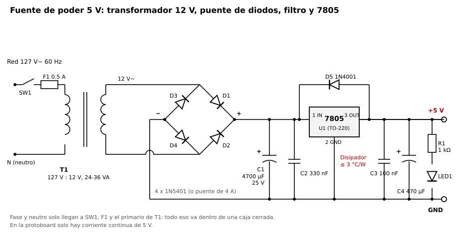

# Fuente de poder de 5 V para la computadora

Transformador de 12 V, puente de diodos, filtro con capacitor y regulador 7805. Salida: 5 V de corriente continua para los rieles de las protoboards.

Esquema: `esquema_fuente.svg` (ábrelo en el navegador). Cálculos: `simular-fuente.mjs`.

## Cómo funciona

1. **T1** baja los 127 V de la pared a 12 V de corriente alterna (valor eficaz; el voltaje pico es 17 V).
2. **D1 a D4** (puente) dejan pasar siempre la corriente en el mismo sentido. Dan una onda de 120 pulsos por segundo, siempre positiva.
3. **C1** se carga en cada pico y entrega corriente entre picos. Convierte los pulsos en un voltaje casi plano (13 a 15 V) con un rizado pequeño.
4. **U1 (7805)** recorta ese voltaje a 5.0 V fijos. Todo lo que sobra se convierte en calor.
5. **C2, C3, C4** estabilizan el 7805 y absorben los saltos de corriente de los chips. **D5** protege al 7805 cuando se apaga. **R1 y LED1** indican que hay salida.

## Lista de materiales

| Ref. | Pieza | Valor | Nota |
|---|---|---|---|
| T1 | Transformador | 127 V a 12 V, mínimo 2 A (24 VA); mejor 3 A | Sin derivación central, o usa solo las dos puntas de 12 V. |
| SW1 | Interruptor | de red, 2 A o más | Opcional pero recomendable. |
| F1 | Fusible con portafusible | 0.5 A, de acción lenta | En el primario (lado de 127 V). |
| D1 a D4 | Diodos | 1N5401 (3 A, 100 V) | O un puente de 4 A (GBU4A, KBPC). Los 1N4007 no sirven: aguantan solo 1 A. |
| C1 | Electrolítico | 4700 µF, 25 V | Respeta la polaridad. |
| C2 | Cerámico o poliéster | 330 nF | Pegado a las patas del 7805. |
| U1 | Regulador | 7805 (TO-220) | Con disipador y pasta térmica. |
| C3 | Cerámico | 100 nF | Pegado a la salida del 7805. |
| C4 | Electrolítico | 470 µF, 16 V | Respeta la polaridad. |
| D5 | Diodo | 1N4001 | Cátodo (raya) hacia la entrada del 7805. |
| R1 | Resistencia | 1 kΩ, 1/4 W | Limita el LED a unos 3 mA. |
| LED1 | LED | cualquiera | |
| — | Disipador para TO-220 | 3 °C/W o menos | Ver sección de calor. |
| — | Caja, cables, tornillos | | Para tapar todo lo de 127 V. |

## Resultados del cálculo

`node fuente/simular-fuente.mjs` calcula el voltaje de C1 con transformador de 12 V, dos diodos en conducción (1.7 V de caída) y 1 Ω de resistencia del devanado. Es un modelo numérico, no un simulador de circuitos completo.

| Consumo | Voltaje en C1 (mín. a máx.) | Rizado | Pico en cada diodo | Calor en el 7805 |
|---|---|---|---|---|
| 0.5 A | 15.3 a 16.0 V | 0.7 V | 2.4 A | 5.3 W |
| 1.0 A | 13.7 a 14.8 V | 1.1 V | 3.8 A | 9.3 W |
| 1.5 A | 12.3 a 13.9 V | 1.5 V | 4.9 A | 12.2 W |

- El 7805 necesita al menos 7 V en su entrada. El mínimo calculado (12.3 V con 1.5 A) lo cumple con margen, incluso con la red 10 % baja (9.5 V con 1 A).
- Sin carga el voltaje de C1 llega a 17.8 V, por eso C1 es de 25 V.
- Con 2200 µF el rizado a 1 A sube a 2.4 V, todavía funciona. Con 4700 µF queda mucho mejor.
- Los diodos reciben picos de 4 a 5 A en cada ciclo, pero cortos. Un 1N5401 los aguanta (3 A promedio, 200 A de pico no repetitivo).

## El problema del calor

El 7805 es un regulador lineal: disipa (voltaje de C1 menos 5 V) por la corriente. Con 1 A son unos 9 W, y sin disipador se quema o se apaga solo en segundos.

- Disipador necesario con 1 A: 3 °C/W o menos (grande, con aletas altas). Con 0.5 A basta uno de 10 °C/W.
- La lengüeta del 7805 está conectada a GND (pata 2), así que el disipador queda a tierra. No necesita aislante, pero que no toque otras partes metálicas.
- Si pasa de 1 A real, usa ventilador o cambia a un módulo reductor (buck) de 5 V y 3 A.
- Antes de decidir, mide el consumo real: conecta la computadora a tu fuente de laboratorio, con el límite en 2 A, y anota la corriente con todo encendido. Esa cifra define el disipador.
- El 7805 entrega máximo 1.5 A con buen disipador. Si la computadora consume más, esta fuente no alcanza.

## Armado

1. **Todo lo de 127 V va dentro de una caja cerrada.** Aísla cada empalme con termoencogible. Nunca armes ni cambies cables con la fuente conectada a la pared.
2. Arma primero la parte de baja tensión (puente, C1, 7805, C2, C3, C4, LED) en una protoboard o placa perforada, con cable grueso (calibre 18 a 22) en las líneas de 12 V y 5 V.
3. Conecta T1, F1 y SW1 al final, sin enchufar.

### Pruebas, en este orden

| Paso | Qué haces | Qué debes medir |
|---|---|---|
| 1 | Enchufa solo T1 con F1, sin nada en el secundario. Multímetro en CA entre los dos hilos del secundario. | 12 a 14 V CA. |
| 2 | Apaga y espera. Conecta el secundario al puente y a C1. Mide CC en C1. | 16 a 18 V CC sin carga. |
| 3 | Con el 7805 conectado y sin carga, mide la salida. | 4.9 a 5.1 V. El LED enciende. |
| 4 | Pon una resistencia de 10 Ω / 5 W como carga (0.5 A). Mide salida y toca el disipador con cuidado. | 5 V estables, disipador tibio. |
| 5 | Conecta los rieles de las protoboards, sin chips. Mide. | 5 V. |
| 6 | Pon los chips por etapas, igual que en el plan, y revisa 5 V y temperatura en cada una. | 5 V ± 0.25 V. |

Si en el paso 2 mides 0 V o un voltaje bajo, revisa el puente: un diodo invertido hace cortocircuito y calienta T1.

## Cosas que no deben pasar

- C1 o C4 con la polaridad invertida: pueden reventar.
- Diodos 1N4007 en el puente: aguantan solo 1 A y se queman.
- Fusible de 0.5 A en el secundario en vez del primario: el fusible va en el lado de 127 V.
- Conectar la salida de esta fuente en paralelo con la fuente de laboratorio: usa una sola a la vez.
